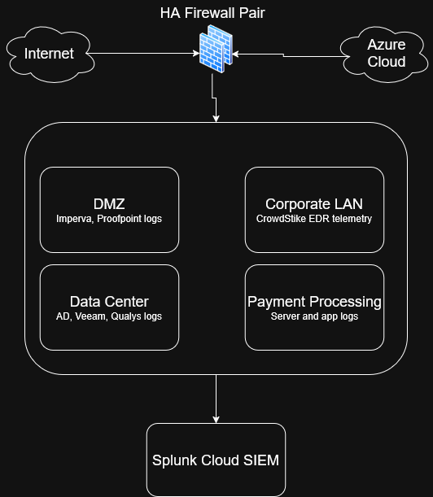

# SIEM Implementation in a Corporate Environment
**Status:** Completed | **Type:** M.S. Capstone Project

**Project Context:** This capstone designs a Splunk Cloud SIEM for FinTek, a simulated 475-employee fintech company preparing for a PCI DSS audit. The company, environment, and post-implementation results are modeled rather than measured. The design follows real frameworks: NIST CSF 2.0, PCI DSS v4.0.1 Requirement 10, MITRE ATT&CK, and the SANS Log Management Policy.

[**Implementation Plan (PDF)**](../files/SIEM_Implementation_Plan.pdf) | [**Post-Implementation Report (PDF)**](../files/SIEM_Post-Implementation_Report.pdf)

## Executive Summary
FinTek has about 475 employees, a 6-person Security Operations Center (SOC), and 8 security tools that don't share data. Each tool kept its own logs in its own format. During an investigation, analysts had to log in to each console and line up the evidence by hand. This slowed detection and response, and it left FinTek unable to produce tamper-evident audit evidence for its upcoming PCI DSS audit.

The design brings all eight log sources into one Splunk Cloud SIEM, adds correlation rules mapped to MITRE ATT&CK, and defines new policies to close all four findings from an internal PCI DSS pre-assessment. The post-implementation report then models how the environment would perform after go-live.

| Metric | Before SIEM | Modeled After SIEM |
| :--- | :--- | :--- |
| **Mean Time to Detect (MTTD)** | 9.5 hours | **~1.5 hours** |
| **Mean Time to Respond (MTTR)** | 17 hours | **~4 hours** |
| **Analyst time on alert handling** | ~5 hours / analyst / day | **~2 hours / analyst / day** |
| **Log sources correlated** | 0 of 8 (siloed consoles) | **8 of 8 normalized** |
| **PCI DSS Req. 10 findings open** | 4 | **0** |

---

## The Problem
An analysis of the environment found three root causes:

1. **No central platform for collecting and correlating logs.** Palo Alto NGFW, CrowdStrike Falcon, Windows Server/Active Directory, Proofpoint, Qualys, Imperva WAF, Veeam, and Azure Monitor each stored logs in their own consoles.
2. **No standard logging schema.** Field names, timestamp formats, and severity scales differed from tool to tool, so analysts had to reconcile them by hand.
3. **No automated alerting across tools.** Each tool could only alert on its own data, so multi-stage attacks and lateral movement could go unnoticed.

**Baseline SOC metrics:** 340 alerts/day, 85% requiring manual triage. The average full investigation took 12 minutes, and 7 of those minutes went to gathering and correlating logs. About 22% of alerts were closed without a full investigation because of the backlog, and the team logged about 48 hours of overtime per month.

---

## Architecture & Design
The SIEM collects logs from every network segment (DMZ, Corporate LAN, Data Center, and the Payment Processing/Cardholder Data Environment) through syslog, agent-based, and API-based forwarding.

| Segment | Log Sources |
| :--- | :--- |
| **Perimeter** | Redundant Palo Alto NGFW pair (firewall logs) |
| **DMZ** | Imperva WAF, Proofpoint email gateway |
| **Corporate LAN** | CrowdStrike Falcon EDR telemetry |
| **Data Center** | Active Directory, Veeam backups, Qualys scan data |
| **Payment Processing / CDE** | Card-processing server and application logs |
| **Cloud** | Azure Monitor |

### Framework Alignment
* **NIST CSF 2.0 Detect function:** Continuous Monitoring (DE.CM-01, 03, 06, 09) and Adverse Event Analysis (DE.AE-02, 03, 04, 07).
* **MITRE ATT&CK:** Every correlation rule is mapped to an ATT&CK technique, so detections are based on known adversary behavior.
* **SANS Log Management Policy:** Guided centralized collection, retention, and role-based access control.

---

## Security Policies Implemented
Each policy closes a finding from the internal PCI DSS v4.0.1 pre-assessment.

| Finding | Policy | PCI DSS Requirement |
| :--- | :--- | :--- |
| Log review was ad hoc | **Scheduled daily log review** of all sources through the SIEM, going beyond the CDE-only minimum | 10.4 |
| Retention ranged from 30 days to 13 months | **Log retention policy:** 3 months immediately searchable, months 4–12 archived | 10.5.1 |
| No way to detect tampering with logs | **Log integrity policy:** write-protected indexed storage, cryptographic hashing, and an immediate alert on any mismatch | 10.3 |
| No automated alerting on CDE access | **Real-time alerting on CDE access** through correlation rules | 10.4.1.1 |
| — | **Role-based SIEM access** based on least privilege | SANS access control |

---

## Implementation Approach
The project used a **hybrid methodology**. The overall rollout followed six waterfall-style phases, while correlation rules were built, tested, and tuned in iterations.

| Phase | Duration | Focus |
| :--- | :--- | :--- |
| 1. Planning & Scoping | 2 weeks | Log source priorities and compliance mappings |
| 2. Architecture & Deployment | 3 weeks | Stand up Splunk Cloud in a lab environment |
| 3. Log Source Onboarding | 4 weeks | Connect all 8 sources (syslog, agent, API) |
| 4. Use Case & Alert Development | 4 weeks | Correlation rules and role-based dashboards mapped to ATT&CK |
| 5. Testing & Tuning | 3 weeks | Simulated attacks and false-positive reduction |
| 6. Documentation & Reporting | 2 weeks | Runbooks, compliance templates, and the final report |

**Deliverables:** Splunk Cloud instance, network and data-flow diagram, use-case library, role-based SOC dashboards, log-forwarding configuration guides, incident response runbook, PCI DSS compliance reporting template, test summary report, and the final project report.

**Training:** The training plan was role-based. The Lead Security Architect earns the Splunk Core Certified Power User certification, the SOC Manager and analysts earn Splunk Core Certified User, IT staff attend an instructor-led session on log forwarding, and all other employees receive an awareness email.

---

## Validation & Success Metrics
The test plan defines four end-to-end attack scenarios, each tied to a specific root cause or audit finding. The post-implementation report models the results against the acceptance criteria.

1. **Phishing-driven credential compromise with lateral movement toward the CDE**, which requires correlating AD authentication with firewall activity.
2. **Unauthorized access attempt against CDE systems**, testing PCI DSS Req. 10 alerting.
3. **Attempt to tamper with stored log data**, testing the integrity controls.
4. **Multi-source incident** requiring correlation across firewall, EDR, and AD logs at the same time.

| Acceptance Criterion | Target | Modeled Result |
| :--- | :--- | :--- |
| Log sources ingesting and normalized | 8 of 8 | **8 of 8** |
| Correlation rules validated against ATT&CK | ≥ 10 | **12** |
| Test scenarios detected | 4 of 4 | **4 of 4** |
| Measurable MTTD / MTTR reduction | vs. 9.5 h / 17 h | **~1.5 h / ~4 h** |
| False-positive rate | < 5% | **12% on first pass, under 5% after tuning** |

**Tuning cycle:** In the modeled first round of testing, the multi-source scenario has a 12% false-positive rate, so the rules go back to Phase 4. There, correlation thresholds are adjusted and suppression logic is added for known-benign admin activity. The retest comes in under the 5% ceiling, and all four scenarios are still detected.

---

## Cost-Benefit Analysis
| Item | Cost |
| :--- | :--- |
| Splunk Cloud licensing (12 GB/day × $10/GB) | $43,800 / year |
| Initial implementation | $15,000 (one time) |
| Certification exam fees (8 exams) | $1,040 |
| **Year 1 total** | **~$59,840** |
| **Analyst time lost to manual investigation (before)** | **~$230,000 / year** |

The projected first-year cost is about a quarter of what FinTek was losing each year to manual investigation. After that, the cost drops to the $43,800 annual license.

---

## Post-Implementation Risks & Maintenance
| Risk | Likelihood / Impact | Mitigation |
| :--- | :--- | :--- |
| Correlation rules going stale as attacks evolve | Medium / Medium | Quarterly review of rules against ATT&CK, with false positives reassessed |
| Dependence on one key person (Lead Security Architect) | Medium / High | Power User training for the SOC Manager, plus detailed guides and documentation of the use-case library |
| Dependence on the cloud vendor | Low / High | Splunk Cloud uptime commitments and a periodic review of contingency plans |

Ongoing maintenance includes continuous monitoring of log source health, refreshing certifications, and an audit-readiness review before each PCI DSS cycle using the compliance reporting template.

---

## Skills Demonstrated
**SIEM architecture (Splunk Cloud)** · **Log normalization & correlation** · **Detection engineering with MITRE ATT&CK** · **PCI DSS v4.0.1 compliance** · **NIST CSF 2.0** · **Security policy development** · **Stakeholder analysis** · **Cost-benefit analysis** · **Test planning (formative & summative)** · **Risk management**

## [Home](/)
